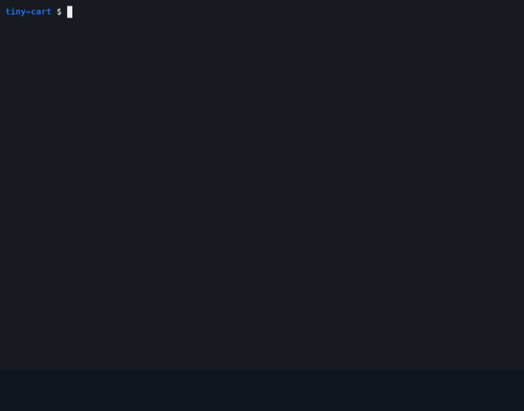

# done-when

**Rough to-dos in, verified commits out.**

[](LICENSE)
[](https://code.claude.com/docs/en/plugins)

A Claude Code plugin that works through a queue while you're away. Every task gets testable **Done when** lines and
failing tests before any code. Then a second agent, which sees only those lines and the diff, decides whether it
ships. You come back to commits you can trust, and to questions only you can answer.



*A real run on a tiny project, about three minutes shown in 45 seconds: one rough line in the queue, one command, one checked commit.*

## Install

```
/plugin install done-when --marketplace martuto31/done-when
```

On Claude Code before 2.1.275: `/plugin marketplace add martuto31/done-when`, then `/plugin install done-when@done-when`.

Then, once per project:

```
/done-when:setup
```

It reads your project, finds and runs your build and test commands, asks you two questions (the branch to commit on,
the areas that are risky) and shows you what it changed. Write a few lines into `QUEUE.md` and run:

```
/done-when:work
```

## Why

Coding agents are good at building and bad at judging what they built. Left alone, they:

- call a task done because their own summary says so;
- turn a red test green by loosening the test;
- ask you about everything, or about nothing;
- can push, deploy or read your `.env` while nobody is watching.

done-when answers each of these with structure, not with longer prompts.

## How it works

```
you write a rough line ─► triage: one-line stub, auto or needs-you, lane
                          spec: Why · Scope · Done when (one testable line each) · Evidence
                          tests first: each Done when line becomes a test, run it, it must FAIL
                          build until those tests pass, plus the build
                          a separate verifier, who never saw the builder's reasoning, checks the diff
                            against the Done when lines (+ a bug-hunting reviewer for money, sign-in, data)
                          PASS ─► one commit with its records      FAIL ─► fix once, then park it
                          queue empty ─► end check: every suite + a UI tester; findings become fix tasks
```

## What makes it different

Specs first, tests first and review agents are common now. These five are what done-when adds:

1. **A blind pass/fail gate.** The verifier gets the Done when lines and the diff, never the builder's reasoning,
   summary or report. Its verdict decides the commit.
2. **Weakening a test is a FAIL.** A diff that deletes, skips or loosens a test the task didn't ask to change fails,
   whatever else it does.
3. **It asks you only what's yours:** money, legal risk, direction, or taste on something you can see. Each question
   comes with a suggested answer and says what happens if you don't reply. Everything else is decided, written
   down and done.
4. **A release gate.** When the queue is empty, every suite runs and a UI tester clicks through at phone and desktop
   widths. What it finds becomes new tasks. What only a person can judge goes on a short `TEST-BY-HAND.md` list.
5. **Safe to leave running.** Push, deploy, `reset --hard`, killing processes and reading `.env` are denied in every
   permission mode. A secret scan runs on each commit, test coverage can only go up, and a task that fails its check
   twice is parked on its own branch while the queue moves on.

## How it compares

- **[superpowers](https://github.com/obra/superpowers)** plans a feature and builds it with a fresh subagent per task
  and a review after each. Its reviewer also reads the builder's report, as claims to check; done-when's verifier
  never sees it. done-when adds the queue, the rule about questions and the release gate. The two work well together:
  superpowers to design a feature, done-when to work through the backlog.
- **[spec-kit](https://github.com/github/spec-kit), [OpenSpec](https://github.com/Fission-AI/OpenSpec), Kiro specs**
  are strong at writing the spec. Checking the result against it is left to you.
- **[BMAD](https://github.com/bmad-code-org/BMAD-METHOD)** runs a full agile team of personas. Its blind reviewer sees
  only the diff, but its findings go to triage rather than deciding the commit.
- **[GSD](https://github.com/open-gsd/gsd-core) and Ralph loops** are built for long unattended runs. done-when is
  smaller (about 20 text files, no packages) and puts every commit behind the gate above.

Compared in October 2026; corrections are welcome.

## Who it's for

Solo developers and small teams shipping a real product with Claude Code, who want to queue work, walk away and come
back to commits they can trust. Also anyone who has watched an agent "fix" a failing test by weakening it.

It fits less well where every change goes through a pull request (done-when commits on a working branch and you push),
or on a quick prototype where tests aren't worth writing yet.

## Everyday use

| You | What happens |
|---|---|
| Write rough lines under `QUEUE.md` → Intake | Triaged on the next round. Exact values in quotes ship as written; a line ending in `!` jumps the queue |
| `/done-when:work` | Works the queue until it's empty. `/done-when:work dry` shows what would run |
| `sh scripts/agents.sh` | The same in the background, restarted after a usage limit (`log`, `stop`) |
| Answer `QUEUE.md` → Needs you | Write `**Answer (you, date):** …` under the question; the next round acts on it |
| Before a release | Walk `TEST-BY-HAND.md`, then push and deploy yourself |

## What it adds to your project

| File | What it is |
|---|---|
| `QUEUE.md`, `QUEUE-done.md` | Intake, Triaged, Work order, Needs you; finished tasks |
| `WORKER.md` | The standing orders the builder follows for every task |
| `CLAUDE.md` (a block at the top) | The house rules every agent repeats |
| `TEST-BY-HAND.md` | What a person checks before a release |
| `docs/CONVENTIONS.md`, `docs/decisions/` | Commit messages, decision records, code comments |
| `.claude/settings.json` | The deny rules: no push, no deploy, no `.env`, no killing processes |
| `scripts/qa.sh` | One gate command with a coverage floor that only goes up |
| `scripts/hooks/commit-msg`, `scripts/install-hooks.sh` | Commit title check and a secret scan (`gitleaks`, optional) |
| `scripts/agents.sh` | Runs the queue in the background |

The plugin itself holds the four agents (worker, verifier, reviewer, ui-tester) and the two commands.

## Cost

Every task runs at least two agents, so it spends more tokens than a single chat. A task tagged `small` runs on a
cheaper model with a lighter check, and the whole suites run once at the end, not after every task.

## Without the plugin

The kit also works copied into a project. In the project's folder:

```bash
git clone --depth 1 https://github.com/martuto31/done-when .done-when
```

Then paste this into Claude Code:

```
Set up the workflow in .done-when/ for this project. Follow .done-when/skills/setup/SKILL.md, where
${CLAUDE_PLUGIN_ROOT} means .done-when. Also copy .done-when/agents/ into .claude/agents/ and
.done-when/skills/work/ into .claude/skills/work/. The command is then /work: write /work wherever the
copied files say /done-when:work. Remove .done-when/ at the end.
```

With another coding agent, run the loop by hand: one session builds and stops at READY; a second, fresh session gets
only the Done when lines and `git diff`, and answers PASS or FAIL.

## The method

[`docs/WORKFLOW.md`](docs/WORKFLOW.md) explains each step and why it exists.

## License

[MIT](LICENSE)
